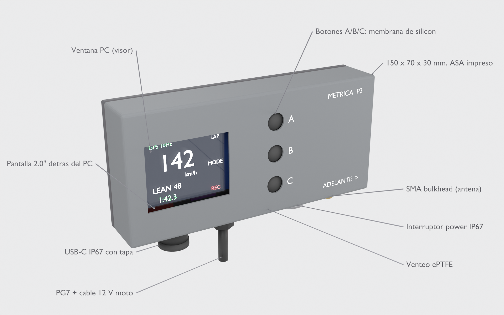
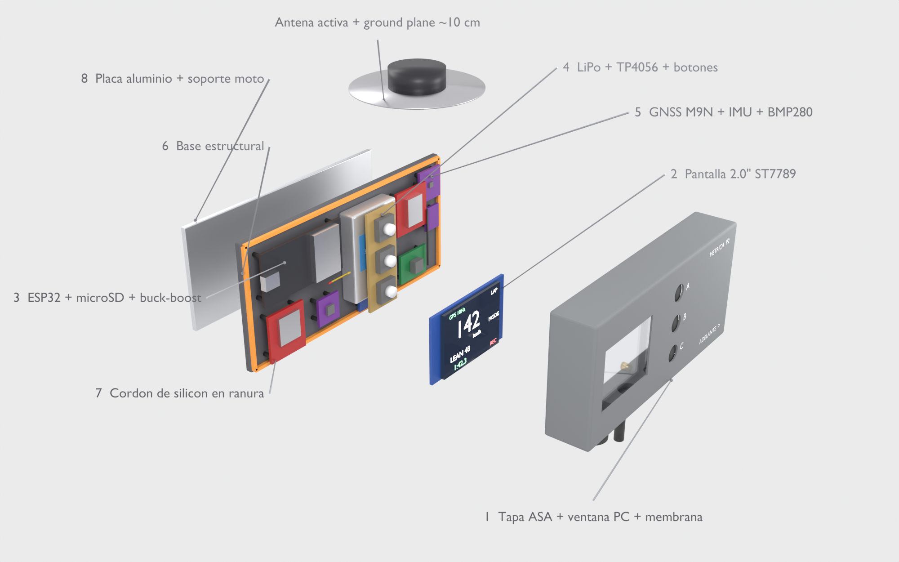
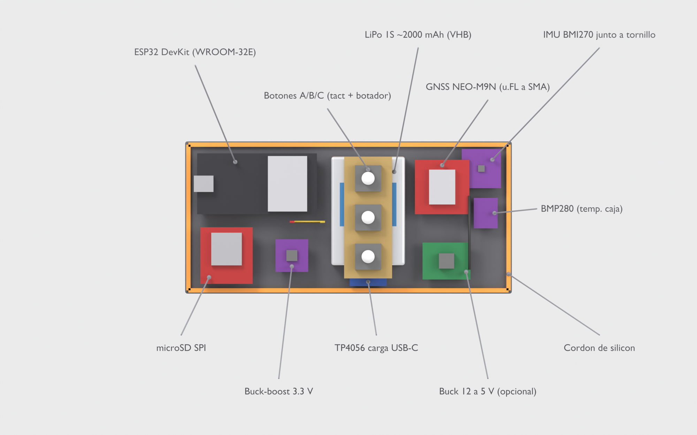

# Prototipo 2: caja 150 × 70 × 30 mm (ESP32 suelto + batería propia)

> Cambio vs el prototipo 1: ya no es el stack M5Stack de 54 × 54. Se usa una
> placa ESP32 genérica y una batería propia, así que los componentes se
> acomodan **lado a lado en una sola capa** dentro de una caja delgada.
> Prototipo honesto: carcasa impresa, sin CNC ni renders de producto.
> Archivos de taller (fotos, medidas, STL): Nextcloud `Proyectos/Metrica/Hardware/prototipo 2`.

## CAD imprimible (CadQuery)

`prototipo2/cad/metrica_p2.py` genera la caja paramétrica: todas las medidas están
arriba del script. Salida en `prototipo2/cad/out/` (STL para imprimir, STEP para Fusion/FreeCAD).

```
~/.venvs/motoline-cad/bin/python hardware/prototipo2/cad/metrica_p2.py
```

| Pieza | Qué trae |
|---|---|
| `p2_tapa` | Esquinas R8, canto frontal R3.5, visera curva sobre la pantalla, ventana con bisel de 45° y bolsillo para PC de 1.2 mm, 3 botones con chaflán y bolsillo de membrana, logo bajo relieve, 5 barrenos de pasamuros abajo (USB-C 16, PG7 12.5, venteo 8, power 16, SMA 6.6), 6 bosses con insertos M3 |
| `p2_base` | Placa de 4 mm, ranura de 2 × 1.5 mm para el cordón, labio de centrado, M3 avellanados por detrás, pad con patrón **AMPS** (insertos M4) para bola RAM de 1" |
| `p2_logo_fill` | Las letras del logo para rellenar (pintura, inserto o impresión a 2 colores) |

Impresión: ASA, 0.2 mm, 4 perímetros (sellado), 20 % gyroid. Tapa con el borde abierto
sobre la cama (soporte solo bajo la visera); base con la cara trasera sobre la cama.

## Renders de visión de producto

`prototipo2/render/`: hechos sobre el CAD real con Blender (escena en
`metrica_p2.blend`). Son **visión de producto**: muestran cómo se vería la
pieza impresa y terminada; la electrónica interna son bloques.

## Renders de distribución (bloques)

Bloques a escala con las medidas de este doc, no CAD final. Se regeneran con
`prototipo2/render_prototipo2.py` (Blender 5, instrucciones en el encabezado).

| Armado | Explosionado | Distribución interna |
|---|---|---|
|  |  |  |

## Supuestos (confirmar)

| Tema | Supuesto | Si cambia |
|---|---|---|
| Medidas externas | **150 ancho × 70 alto × 30 fondo** (mm) | Fondo de 30 **cm** no tiene sentido en moto; se asume mm. |
| Placa | ESP32-DevKitC / WROOM-32E, ~55 × 28 × 13 mm con headers | ESP32-S3: más cambios de firmware (USB nativo, pines). |
| GNSS | Breakout **NEO-M9N** (mismo chip del BOM), con u.FL o SMA | — |
| IMU / baro | Breakout **BMI270** (+ BMP280 opcional) por I2C | — |
| Pantalla | Módulo IPS **2.0" ST7789** SPI (~35 × 58 mm) | La decisión 5 (display sí) sigue. |
| Batería | **LiPo 1S** de bolsa, ~3000 mAh, ≤ 10 mm de grueso (p. ej. 50 × 60 × 9) | Con 2S o 18650 cambia la zona 2 y la regulación. |
| microSD | Breakout SPI aparte (la DevKit no trae slot) | — |

Esto **reabre la decisión 5** de `DECISIONS.md` (el Basic reemplazó a StampS3A
+ microSD suelta). Registrar la nueva decisión ahí cuando se confirme la placa.

## Arquitectura de la caja

La caja son dos piezas:

- **Base trasera (estructural):** placa de 150 × 70 × ~4 mm que se atornilla al
  soporte de la moto. **Toda la electrónica se fija a la base**, incluida la IMU.
  Es la parte más rígida del sistema.
- **Tapa frontal (carcasa):** ASA o PETG impreso (PLA se deforma al sol), con
  la ventana de PC transparente pegada y los 3 botones. Cierra contra la base
  con **cordón de silicón de 2 mm en ranura** y 6 tornillos M3 a insertos de
  latón. La pantalla y los botones se conectan a la base con un arnés JST.

Medidas internas útiles con paredes de 3 mm: **~144 × 64 × 23 mm**
(30 − 4 base − 3 frente). Todo debe caber en 23 mm de fondo.

## Distribución (vista frontal, lado del piloto)

```
 ◄────────────────────────── 150 mm ──────────────────────────►
┌──────────────────────┬──────────────────┬───────────────────┐ ▲
│  ZONA 1              │  ZONA 2          │  ZONA 3           │ │
│ ┌──────────────────┐ │                  │                   │ │
│ │ VENTANA PC       │ │   ( A )          │  GNSS M9N         │ │
│ │ pantalla 2.0"    │ │   ( B )          │  IMU BMI270 ●     │ 70
│ │ (horizontal)     │ │   ( C )          │  (junto a tornillo│ │
│ └──────────────────┘ │                  │   de montaje)     │ │
│  detrás: ESP32 +     │ detrás: LiPo     │                   │ │
│  microSD             │ + cargador/BMS   │                   │ │
└──────────────────────┴──────────────────┴───────────────────┘ ▼
   pared inferior:  [USB-C IP67]  [PG7 12V]  [venteo]   [SMA]  ◄ pared derecha o inferior
```

### Zona 1: pantalla + cerebro (~60 mm)

- Pantalla en **horizontal (320 × 240)**, detrás de la ventana, a 1 mm del PC.
- Detrás de la pantalla: ESP32 DevKit (13 mm) + breakout microSD. 4 + 13 = 17 mm
  de 23, sobra para cables.
- **Acceso a la microSD:** al quitar la tapa. La subida por Wi-Fi hace que casi no
  se use en pits.
- Antena PCB del ESP32 **hacia el borde superior**, lejos de la batería y de la
  antena GNSS, sin tierra ni cobre encima. ASA/PC no bloquean 2.4 GHz.

### Zona 2: botones + energía (~40 mm)

- **A / B / C en vertical** al centro (o en fila bajo la pantalla si se prefiere
  que cada etiqueta quede justo encima de su botón: pantalla arriba de 70 mm,
  botones abajo; cabe con pantalla de 2.0").
- Botones: 3 tact switches de 12 mm en una placa perforada atornillada a la base,
  con **membrana de silicón de 1 mm** pegada con RTV por dentro de la tapa y un
  botador impreso. Funciona con guante y sella IP65. Alternativa: pulsadores
  IP67 de 12 mm de panel (más caros, más fáciles de sellar).
- **LiPo plana** pegada a la base con VHB, **detrás de una parte opaca de la tapa**,
  no detrás de la ventana (efecto invernadero).
- Cargador USB-C + protección (TP4056 con DW01 o mejor MCP73831), y
  **regulación 3.3 V de buck-boost** (TPS63020/TPS63802). Ver §Energía.
- **Interruptor de encendido IP67** (pulsador o palanca de panel), porque el ESP32
  suelto no trae el botón de power del Basic.

### Zona 3: GNSS + IMU (~44 mm)

- **IMU atornillada directo a la base**, junto a uno de los tornillos de montaje
  a la moto, con 4 separadores M2/M2.5 cortos. Sin espuma ni hule.
- Ejes de la IMU **alineados con la caja**: X hacia adelante, Z arriba. Flecha
  "ADELANTE" en la tapa. El firmware no calibra orientación: todas las unidades
  se montan igual.
- NEO-M9N al lado, con **pigtail u.FL → SMA bulkhead** a la pared derecha o inferior.
- Breakout BMP280 opcional aquí (baro raw). Su temperatura del die sirve para
  medir el calor dentro de la caja.

## Pasamuros (pared inferior, los conectores nunca arriba)

| Paso | Pieza | Nota |
|---|---|---|
| Antena GNSS | **SMA bulkhead hembra IP67 con O-ring** + pigtail u.FL (o jumper SMA si el breakout trae SMA) | Pasa la alimentación de la antena activa. SMA, no RP-SMA. |
| USB-C | **Pasamuros USB-C IP67 con tapa, con datos** | Flasheo, serial `LOG`/`PAIR`/`WIFI`, carga y 5 V de la moto. Barreno 16 o 20 mm según modelo: con 30 mm de pared cabe. |
| 12 V moto (opcional) | **PG7** + buck **fijo** 12→5 V hacia la entrada del cargador | Fusible en línea del lado de la moto. |
| Respiro | **Venteo ePTFE M8** (el M12 no cabe bien en 30 mm) | Evita condensación. |

## Energía

- La DevKit trae un **AMS1117** (caída ~1.1 V). Alimentada directo de la LiPo
  (4.2 → 3.0 V) se apaga a media batería y los picos de Wi-Fi (~500 mA) la
  reinician. Alimentar el **pin 3V3** desde un buck-boost 3.3 V, no el pin 5V.
- Medir batería con divisor resistivo a un GPIO ADC1 (p. ej. GPIO36/39); el
  firmware usa hoy `M5.Power`.
- Cargar solo entre 0 y 45 °C: el cargador no lo sabe, el firmware puede
  avisarlo con la temperatura del BMP280.

## Montaje en la moto

- En el **soporte fijo del tablero / araña del carenado**, no en el manubrio (ahí
  la IMU gira con la dirección y ensucia el yaw).
- 4 tornillos M4 que pasan por la base a una placa de aluminio, sin silentblocks.
  El formato 150 × 70 cabe en el hueco de tablero de muchas motos de pista.
- **Antena:** punto alto despejado. En fibra el imán no pega: ground plane de
  lámina de acero (~10 cm) con 3M VHB y el imán encima. Cable lejos de la pipa
  de dirección.

## Impacto en firmware (no se toca desde la caja, pero hay que planearlo)

- `platformio.ini`: `board = m5stack-core-esp32` → la placa nueva. Las particiones
  son `default_16MB.csv`: elegir módulo **WROOM-32E de 8 o 16 MB** (N8/N16). Con
  4 MB hay que cambiar la tabla y se pierde margen.
- `M5Unified` maneja hoy pantalla, botones, SD y batería. Con hardware propio:
  configurar M5GFX para el ST7789 (o cambiar a TFT_eSPI / LovyanGFX), botones a
  GPIOs con pull-up, SD por SPI con su CS, batería por ADC.
- `HardwareConfig.h`: nuevos pines. El problema de DIP del M135 desaparece porque
  el cableado es directo. Siguen las reglas: **nada en GPIO0/GPIO12 que cambie al
  arranque**, GPIO34–39 solo entrada (sirven para PPS y botones con pull-up externo).
- Propuesta inicial de pines (verificar contra la placa real):

| Señal | GPIO |
|---|---|
| GNSS UART RX / TX / PPS | 16 / 17 / 34 |
| I2C SDA / SCL (IMU, baro) | 21 / 22 |
| SPI SCK / MOSI / MISO (pantalla + SD) | 18 / 23 / 19 |
| Pantalla CS / DC / RST / backlight | 5 / 27 / 33 / 32 |
| SD CS | 4 |
| Botones A / B / C (pull-up externo 10 k en 35/39) | 35 / 39 / 25 |
| Batería ADC (divisor) | 36 |

## Riesgos a probar con la unidad 1

1. **Calor:** 1 h al sol grabando, mirando la temperatura del BMP280. Si pasa de
   ~55 °C: visera impresa y batería más lejos de la ventana.
2. **Agua:** manguera 3 min por lado con papel absorbente dentro. Las piezas
   impresas filtran: imprimir con ≥ 4 perímetros, o sellar con barniz o resina.
3. **Lectura al sol:** un ST7789 genérico da ~300–400 nit, mucho menos que los
   853 del Basic. Probarlo con la película antirreflejo; si no se lee, buscar
   módulo de alto brillo o tipo transflectivo.
4. **Botones:** 50 pulsaciones con guante, sin falsos ni dobles.
5. **Radio:** BLE con la app y subida Wi-Fi con la caja cerrada.
6. **GNSS:** fix y 10 Hz con la antena montada; jitter lateral vs prototipo 1.
7. **Vibración / IMU:** una rodada; ruido del acelerómetro vs prototipo 1. Si hay
   resonancia, rigidizar la base, no aislar con hule.
