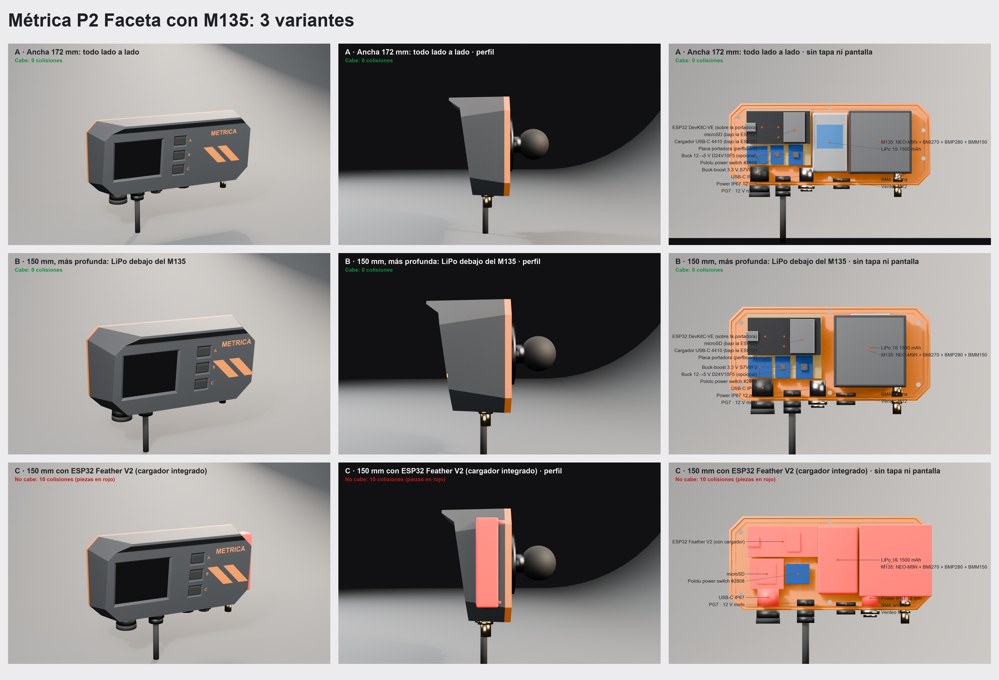

# Faceta con M135: 3 variantes

Se cambian los 3 breakouts (GNSS NEO-M9N, IMU BMI270, BMP280) por el **M5Stack Module
GNSS M135** (los mismos chips + magnetómetro BMM150, ~45 USD contra ~100 USD).
El M135 mide 54×54×13.2 mm y no cabe en la Faceta de 150 mm junto a la ESP32 y la LiPo;
estas son las 3 formas de acomodarlo.



| | A · Ancha | B · Profunda | C · Feather |
|---|---|---|---|
| Carpeta | [A_ancha/](A_ancha/) | [B_profunda/](B_profunda/) | [C_feather/](C_feather/) |
| Medidas exteriores (sin base) | **172** × 70 × 22–32 mm | 150 × 70 × **32–42** mm | 150 × 70 × 22–32 mm |
| ¿Cabe? | ✅ 0 colisiones | ✅ 0 colisiones | ❌ 10 colisiones |
| Cómo | ESP32 + portadora · LiPo · M135, lado a lado | LiPo **debajo** del M135 (M135 en separadores de 10 mm) | Feather V2 (cargador integrado), todo lado a lado |
| Contra | 22 mm más ancha | 10 mm más profunda; caja más voluminosa vista de lado | El M135 choca con la pared derecha y queda bajo la placa de botones |
| Cambio de BOM | +M135, −GNSS/IMU/BMP280 | igual que A | además ESP32 Feather V2 en lugar de DevKitC-VE + cargador 4410 |

**Placa portadora (A y B):** los módulos chicos (microSD, cargador, power switch Pololu,
buck-boost y buck 12 V opcional) van en una perfboard de 56×48 mm; la ESP32 DevKitC-VE
se monta encima en headers hembra de 8.5 mm. Así ocupan la huella de la ESP32 y no espacio extra.

## Archivos por carpeta

| Archivo | Qué es |
|---|---|
| `variant.json` | Parámetros del CAD (`cad`) y posición de cada pieza (`parts`) |
| `out/p2m135_*.stl / .step` | Tapa, base, relleno de logo y chevron para imprimir |
| `colisiones.txt` | Resultado del chequeo de colisiones |
| `01_frente.png` … `04_sin_tapa.png` | Renders con etiquetas (piezas en rojo = colisión) |
| `_views/` | Escenas de Blender de cada vista |

## Regenerar

```bash
cd hardware/prototipo2/m135
python3 make_variants.py                                   # variant.json
~/.venvs/motoline-cad/bin/python ../cad/metrica_p2_v2_faceta.py A_ancha/variant.json   # CAD (x3)
# en Blender (MCP): VARIANT="…/m135/A_ancha"; exec(open("…/render/build_variant.py").read())
# render: blender -b _views/frente.blend --python ../render/eevee_setup.py -f 1
~/.venvs/motoline-cad/bin/python annotate_variants.py      # etiquetas + comparativa
```

Las medidas de las placas son las de catálogo; al tener las piezas físicas, medir y volver
a correr el chequeo.
